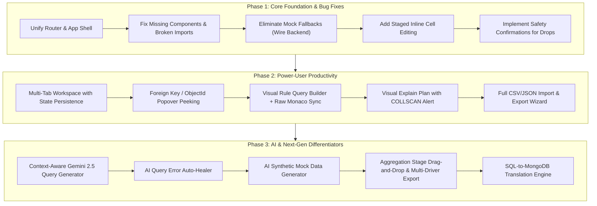

# 🧭 Database Explorer — Comprehensive Market Analysis, User Requirements & Feature Specification

> **Document Type:** Product Requirement Document (PRD) & Market Benchmark Analysis  
> **Target Application:** DB Explorer (Full-Stack MongoDB Studio & AI Query Assistant)  
> **Status:** Pending User Review & Approval before Development Kick-off  
> **Target Audience:** Engineering Leads, Product Designers, Full-Stack Developers  

---

## Executive Summary

**DB Explorer** is currently positioned as a developer-centric, web-based MongoDB administration and query studio. A thorough audit of the existing codebase reveals a strong architectural foundation (dynamic low-level `mongodb` driver connection pooling, EJSON parsing, visual query builder, stage-by-stage aggregation pipeline visualizer, schema inference, index viewer, and Google Gemini AI integration).

However, when benchmarked against industry standards—such as **MongoDB Compass**, **Studio 3T**, **TablePlus**, **Supabase Studio**, and **DBeaver**—there are critical functional gaps, usability friction points, and opportunities for next-generation features that can transform DB Explorer from a basic query viewer into a **daily-driver database workspace**.

This document provides:
1. **In-Depth Audit of Current Codebase**: Features implemented vs. mock/disconnected states.
2. **Competitive Market Benchmark**: Detailed comparison against MongoDB Compass, Studio 3T, TablePlus, DBeaver, and Supabase Studio.
3. **User Personas & Pain Points**: Why developers abandon standard database tools.
4. **Prioritized Feature Matrix**:
   - 🔴 **Must-Have (Core & Critical)** — Essential for everyday productivity and reliability.
   - 🟡 **Should-Have (Advanced & Ergonomic)** — Eliminates friction, matches Compass & TablePlus.
   - 🟢 **Good-to-Have (Delighters & Superpowers)** — Unique differentiators (AI features, visualizations, migrations).
5. **UI / UX & Usability Design Enhancements**: Making the studio intuitive, responsive, and keyboard-first.
6. **Technical & Architectural Recommendations**: Performance virtualizations, streaming, and connection resilience.

---

## 1. Project Audit: Current State of "DB Explorer"

### 1.1 What Is Currently Implemented (Working / Semi-Working)

| Module | Implemented Features | Current State |
| :--- | :--- | :--- |
| **Backend Driver** | Dynamic connection pooling via native `mongodb` driver, EJSON serializer/deserializer (`ObjectId`, `Date`, etc.). | ✅ Solid foundation in `server/src/services/mongoManager.ts`. |
| **Connection Manager** | URI connection string, ping latency test, list databases and collections, read-only safety mode toggle. | ⚠️ Stored in browser `localStorage`, basic URI validation. |
| **Document Querying** | Filter, Projection, Sort, Skip, Limit endpoints (`/api/documents/:db/:col/query`). | ✅ Works via backend API. |
| **CRUD Operations** | Insert one/many, update one, delete one document. | ✅ Implemented on server and client modal. |
| **Schema Inferrer** | Document sampling (default 100 docs) to discover field paths, detected BSON types, presence %, and sample value. | ✅ Implemented both on backend and fallback on frontend. |
| **Index Inspector** | Lists indexes on collections, index creation, index deletion. | ⚠️ Backend implemented; frontend has static mock index fallback in `lib/db-schema.ts`. |
| **Aggregation Builder** | Stage-by-stage pipeline builder (`$match`, `$group`, `$project`, etc.) with stage previews and Recharts bar chart. | ⚠️ Two parallel implementations: a backend runner and an in-browser mock runner in `lib/aggregation.ts`. |
| **AI Query Assistant** | Natural language to MongoDB filter/pipeline and query explainer via Google Gemini API. | ⚠️ Backend has Gemini 2.5 Flash service, but frontend also has a local regex fallback in `lib/ai-assistant.ts`. |
| **Diagnostics & Server Info** | Server status endpoint (`host`, `version`, `uptime`, `connections`, `opcounters`, `mem`). | ✅ Server controller exists; modal available in client. |

### 1.2 Critical Internal Disconnects Discovered During Audit

> [!WARNING]
> **Split Identity Between App and Router**:
> The frontend currently contains two divergent application shells:
> 1. `client/src/App.tsx`: Designed as the multi-component live backend studio, but contains missing file imports (`WorkspaceTabBar`, `SchemaInspectorModal`, `AIAssistantDrawer`).
> 2. `client/src/routes/index.tsx`: A TanStack Start route implementation with self-contained tabs, but heavily relies on local mock data fallbacks (`lib/db-data.ts`, `lib/ai-assistant.ts`, `lib/aggregation.ts`).
>
> **Action Required Before Development**: Unify the UI to purely use live backend endpoints and eliminate mock fallbacks so the app seamlessly talks to live MongoDB instances.

---

## 2. Competitive Market Benchmark Matrix

We benchmarked DB Explorer against the top 5 database explorers in the industry:
1. **MongoDB Compass** (Official GUI for MongoDB)
2. **Studio 3T** (Leading enterprise commercial MongoDB IDE)
3. **TablePlus** (High-speed, modern native database client)
4. **Supabase / Prisma Studio** (Leading modern web-based developer data browsers)
5. **DBeaver** (Open-source universal database tool)

| Capability / Feature | MongoDB Compass | Studio 3T | TablePlus | Supabase Studio | DB Explorer (Current) | DB Explorer (Target) |
| :--- | :---: | :---: | :---: | :---: | :---: | :---: |
| **Web-Based (Zero Install)** | ❌ Desktop only | ❌ Desktop only | ❌ Desktop only | ✅ Web UI | ✅ Web UI | ✅ Web UI |
| **Multi-Tab Workspace** | ⚠️ Limited | ✅ Full | ✅ Full | ⚠️ Single DB | ❌ Stored in state | ✅ Persistent Tabs |
| **Spreadsheet Inline Cell Editing** | ❌ Modal edit | ✅ In-place | ✅ Instant in-place | ✅ Instant in-place | ❌ Modal only | ✅ Staged In-place |
| **Foreign Key / ObjectId Hyperlinking**| ❌ No | ✅ Cross-link | ✅ FK lookup | ✅ Relational drawer| ❌ Text only | ✅ One-click preview |
| **Interactive Query Builder** | ✅ Basic bar | ✅ Visual Builder | ✅ Filter rules | ✅ Filter bar | ⚠️ Basic dropdowns | ✅ Visual + Logic Groups |
| **Raw Mongosh Code Editor** | ✅ Embedded shell | ✅ IntelliShell | ❌ SQL only | ❌ SQL only | ⚠️ Textarea only | ✅ Monaco + Autocomplete |
| **SQL-on-MongoDB Querying** | ❌ No | ✅ Full SQL | ❌ No | ❌ (Postgres only)| ❌ No | 🟢 SQL-to-Mongo converter |
| **Aggregation Pipeline Visualizer** | ✅ Stage builder | ✅ Pipeline editor | ❌ No | ❌ No | ⚠️ Basic stages | ✅ Visual stage debugger |
| **Export Pipeline to Drivers** | ✅ Node/Python/C#/Java| ✅ Multi-driver | ❌ No | ❌ No | ❌ No | ✅ 5+ Language Drivers |
| **Visual Query Execution Plan** | ✅ Visual tree | ✅ Visual explain | ⚠️ Text only | ⚠️ Text/Graph | ⚠️ Raw JSON | ✅ Visual Stage Flowchart |
| **Interactive Schema Histograms** | ✅ Charts & shapes | ✅ Schema metrics | ❌ No | ❌ No | ⚠️ Table list only | ✅ Visual Histograms |
| **Data Import/Export (CSV/JSON/NDJSON)**| ✅ Full import wizard| ✅ Full wizard | ✅ CSV/JSON | ✅ CSV/JSON | ⚠️ Client download only| ✅ Multi-format stream |
| **AI Natural Language to Query** | ⚠️ Compass Generative | ❌ Add-on | ❌ No | ✅ Supabase AI | ⚠️ Partial regex/API | ✅ Full Context AI Studio |
| **Safe Production Guards** | ⚠️ Read-only URI | ⚠️ Connection color| ⚠️ Safe mode | ❌ Role-based | ⚠️ Read-only checkbox | ✅ Multi-tier Safety Guard |
| **Connection Security (SSH / SSL / SCRAM)**| ✅ SSH, TLS, X509 | ✅ Full Tunneling | ✅ SSH, TLS, Pass | ⚠️ Cloud Auth | ❌ Plain URI only | ✅ SSH Tunnel + TLS certs |

---

## 3. Comprehensive Feature Specification (Categorized & Prioritized)

To build a best-in-class DB Explorer, features are structured into:
- 🔴 **Tier 1: Must-Have Features (Core & Critical)**
- 🟡 **Tier 2: Should-Have Features (Usability & Performance)**
- 🟢 **Tier 3: Good-to-Have Features (Superpowers & Delighters)**

---

### 🔴 Tier 1: Must-Have Features (Core & Critical)

These are baseline features required for any developer to use the tool reliably in real projects.

#### 1.1 Robust Connection & Environment Architecture
- [ ] **Connection Form Builder & URI Toggle**:
  - Allow connection either by full connection string (`mongodb://...` or `mongodb+srv://...`) OR individual input fields (Host, Port, Database, Username, Password, Auth Source, Replica Set name).
- [ ] **SSL/TLS & Certificate Support**:
  - Support self-signed certificates, CA file upload, and `tlsAllowInvalidCertificates` toggle for development environments.
- [ ] **Environment Color Tagging & Badges**:
  - Assign environment tags: **Production** (Red), **Staging** (Orange), **Development** (Green), **Local** (Blue).
  - Prominent top-bar status banner when connected to a **Production** database to prevent accidental destruction.
- [ ] **Saved Connection Profiles Manager**:
  - Save, edit, rename, duplicate, and delete connection profiles.
  - Export and import connection profiles (with password encryption or password prompt on load).

#### 1.2 High-Performance Document Explorer & Grid System
- [ ] **Spreadsheet-Style Inline Cell Editing (TablePlus-style)**:
  - Double-click any cell to edit strings, numbers, booleans, dates, or null values directly in the table.
  - **Staged Changes Bar**: Highlight modified rows in yellow/blue. Provide a "Review & Save (N changes)" button and a "Discard" button to prevent premature writes.
- [ ] **Column Management**:
  - Column reordering via drag-and-drop.
  - Column visibility toggle (show/hide specific columns).
  - Pin/Freeze important columns (e.g., `_id` always visible on horizontal scroll).
  - Double-click column header boundary to auto-fit column width.
- [ ] **Advanced Multi-View Modes**:
  - **Table View**: Compact, data-dense view with sorting and column resizing.
  - **Tree View**: Interactive collapsible JSON tree with type tags, expand/collapse all, and one-click JSON path copy (`user.profile.address.zip`).
  - **Monaco Code View**: Full-screen Monaco Editor with JSON validation, line numbers, folding, and search (`Ctrl+F`).
- [ ] **Proper BSON Type Handling**:
  - Native display and editing for `ObjectId`, `ISODate`, `NumberLong` (64-bit int), `NumberDecimal`, `Binary / UUID`, and `Boolean`.
  - Type conversion dropdown when creating or updating fields (prevent saving numbers as strings).

#### 1.3 Document CRUD & Bulk Operations
- [ ] **Insert Document Dialog**:
  - Visual field-by-field form OR raw Monaco JSON editor.
  - Document duplication ("Clone Document") with automatic new `_id` generation.
- [ ] **Bulk Operations**:
  - Multi-select checkboxes on table rows.
  - Bulk Delete selected documents with confirmation modal showing total count.
  - Bulk Field Update (e.g., set `status = "inactive"` on 50 selected records).
- [ ] **Keyset & Offset Pagination Controls**:
  - Quick page jump, configurable page sizes (20, 50, 100, 250, 500).
  - Total records count and current range indicator (e.g., `Showing 1–50 of 4,821`).

#### 1.4 Production Safety & Destruction Guards
- [ ] **Multi-Tier Read-Only Mode**:
  - Strict UI lockdown disabling all Insert, Update, Delete, Drop Collection, and Drop Index actions.
- [ ] **Destructive Action Confirmation Safeguard**:
  - Require the user to explicitly type the collection name or database name (e.g., `Type "users" to confirm drop collection`) before dropping collections, dropping indexes, or running unindexed bulk deletes.

---

### 🟡 Tier 2: Should-Have Features (Usability, Performance & Ergonomics)

These features dramatically improve daily developer productivity and match what users expect from MongoDB Compass and TablePlus.

#### 2.1 Multi-Tab Workspace & State Persistence
- [ ] **Browser Multi-Tabs**:
  - Open multiple databases, collections, query tabs, or aggregation pipelines simultaneously in tabs (like VS Code or Chrome).
  - Ability to close tabs, close other tabs, duplicate tab.
  - **Session State Preservation**: Tabs, current queries, and unsaved drafts survive page reloads (persisted in `sessionStorage` / `IndexedDB`).

#### 2.2 Foreign Key / ObjectId Smart Hyperlinks (Reference Navigation)
- [ ] **Smart Reference Peeking**:
  - In MongoDB schemas, fields ending in `Id` or containing `ObjectId` references (e.g., `userId: "64f...abc"`, `orderId`) become clickable hyperlinks.
  - Clicking opens a **quick popover preview drawer** showing the referenced document from the related collection without leaving the current view.
  - Option to "Jump to Document" in a new tab.

#### 2.3 Visual Query Builder & Raw Code Harmony
- [ ] **Nested Rule & Group Builder**:
  - Add multiple filter rules with `AND` / `OR` logical groups.
  - Support comprehensive operators: `=`, `!=`, `>`, `>=`, `<`, `<=`, `in`, `not in`, `contains` (case-insensitive regex), `starts with`, `exists`, `is null`, `type is`, `array contains`.
- [ ] **Bi-Directional Sync**:
  - Updating the Visual Builder automatically updates the raw JSON query, and typing valid JSON in the raw editor reflects back into the Visual Builder rules.
- [ ] **Monaco Editor IntelliSense for MongoDB**:
  - Auto-completion for collection field names, MongoDB operators (`$match`, `$group`, `$regex`, `$in`), and snippets.
- [ ] **Query History, Saved Queries & Bookmarks**:
  - Searchable query execution history with timestamp, duration (ms), row count, and status.
  - "Star / Save Query" with custom name (e.g., "Active Subscriptions 2024") and tags.
  - Quick-insert snippet library for common MongoDB queries.

#### 2.4 Aggregation Pipeline Studio & Exporter
- [ ] **Drag-and-Drop Stage Reordering**:
  - Drag stages up or down to test how pipeline order affects performance and output.
- [ ] **Stage Toggle (Mute/Unmute)**:
  - Temporarily disable an individual stage with an eye icon to debug without deleting the stage definition.
- [ ] **Stage Diff View (Before vs. After)**:
  - Inspect sample documents *entering* the stage and compare against sample documents *exiting* the stage.
- [ ] **Export Pipeline to Application Code**:
  - One-click copy pipeline formatted for:
    - **Node.js / Express** (`collection.aggregate([...])`)
    - **Python (PyMongo)**
    - **Go (mongo-go-driver)**
    - **C# / .NET**
    - **Java (MongoDB Driver)**
    - **mongosh Shell Script**

#### 2.5 Visual Explain Plan & Performance Advisor
- [ ] **Graphical Execution Plan (Explain Visualizer)**:
  - Instead of raw nested JSON, render an interactive flow diagram:
    - Stage boxes: `COLLSCAN` (highlighted in red as a performance risk) vs. `IXSCAN` (highlighted in green).
    - Documents Examined vs. Documents Returned ratio.
    - Execution time breakdown per stage.
- [ ] **Index Advisor**:
  - If a query triggers a full collection scan (`COLLSCAN`) on more than 500 documents, display an inline recommendation banner:
    > *"Warning: Scanned 12,500 documents to return 10. Recommended Compound Index: `{ status: 1, createdAt: -1 }`"*.
  - One-click button: **"Create Recommended Index"**.

#### 2.6 Comprehensive Data Import & Export Suite
- [ ] **Export Options**:
  - Export formats: **JSON** (Formatted or Minified), **EJSON** (preserving BSON types), **CSV** (with nested object flattening), **Excel (.xlsx)**, **NDJSON**.
  - Scope selection: "Export Current Query Results", "Export Selected Rows Only", or "Export Entire Collection".
  - Field selection checklist (choose which fields to include in export).
- [ ] **Import Wizard**:
  - Drag-and-drop file upload for `.json`, `.csv`, `.ndjson`.
  - Field mapping preview and BSON type deduction.
  - Error mode: "Stop on error" vs. "Skip invalid records".
  - Live progress bar showing records inserted per second.

---

### 🟢 Tier 3: Good-to-Have Features (Delighters & Superpowers)

These features will elevate DB Explorer above typical clones, making it an extraordinary portfolio showcase and industry-leading developer tool.

#### 3.1 Next-Gen AI Database Assistant (Gemini 2.5 Integration)
- [ ] **Deep Schema-Aware Natural Language Translation**:
  - Pass collection schema, enum values, and sample values as prompt context so Gemini writes 100% syntactically and semantically correct MongoDB queries.
- [ ] **Multi-Turn Chat & Iterative Query Refinement**:
  - Interactive chat panel: *"Now filter that only for users who spent > 500"*, *"Sort them by registration date descending"*, *"Convert this to an aggregation pipeline grouped by month"*.
- [ ] **AI Query Error Auto-Healer**:
  - When MongoDB throws an error (e.g., `unknown operator: $eql` or `can't $unwind non-array`), display an AI button: **"Auto-Fix Query"** that explains the error and fixes the query syntax with one click.
- [ ] **AI Synthetic Test Data Generator**:
  - In collection view, click **"Generate Mock Data"**: prompt Gemini (e.g., *"Generate 25 realistic Indian e-commerce orders with valid addresses and past dates"*) and bulk insert them into MongoDB instantly.
- [ ] **AI Data Insights & Executive Summarizer**:
  - Click **"Analyze Dataset"** on any query or collection: AI analyzes patterns, anomalies, top customer categories, revenue concentration, and outputs executive bullet points with charts.

#### 3.2 SQL-to-MongoDB Query Engine (Studio 3T Killer Feature)
- [ ] **SQL Query Tab**:
  - Allow developers and data analysts accustomed to SQL to write standard SQL:
    ```sql
    SELECT name, email, total 
    FROM orders 
    WHERE status = 'completed' AND total > 200 
    ORDER BY total DESC 
    LIMIT 20;
    ```
  - Translate under the hood to native MongoDB `find()` or `$match`/`$project`/`$sort` pipeline and execute.

#### 3.3 Visual Schema Insights & Data Quality Engine
- [ ] **Visual Field Histograms (Compass-style)**:
  - Mini frequency distribution charts for every field (e.g., bar chart of `status` values: 60% completed, 30% processing, 10% cancelled).
  - Numeric range distribution (min, max, median, 25th/75th percentile).
- [ ] **Schema Anomaly & Drift Detector**:
  - Scan collection for data inconsistencies:
    - Fields with mixed data types (e.g., `age` stored as string in some docs and integer in others).
    - Orphan fields or typos (e.g., 999 docs have `createdAt`, but 1 doc has `created_at`).
- [ ] **JSON Schema Validation Visualizer**:
  - View, edit, and test collection validation rules (`$jsonSchema`) with visual feedback on which existing documents fail validation.

#### 3.4 Live Cluster Monitoring & Diagnostics Dashboard
- [ ] **Real-Time mongostat / mongotop Graph**:
  - Live charts polling every 2 seconds:
    - Operations per second: Insert, Query, Update, Delete, Command.
    - Network I/O (bytes in / bytes out).
    - Active connections and connection pool usage.
    - Memory usage (resident vs. virtual).

#### 3.5 Database & Collection Utilities
- [ ] **Collection Diff & Comparison Tool**:
  - Compare two collections (or two environments, e.g. Staging vs. Production) to detect schema differences, missing indexes, or count discrepancies.
- [ ] **Field Refactoring & Batch Rename**:
  - One-click tool to rename a field across all documents in a collection (executes `$rename`).
  - Delete a field across all documents (executes `$unset`).

---

## 4. UI / UX Design & Ergonomic Improvements

To make DB Explorer significantly more user-friendly, the following design principles must be implemented:

### 4.1 Layout & Visual Hierarchy
1. **Collapsible 3-Pane Architecture**:
   - **Left**: Database and Collection tree with search filter, document count badges, storage size, and quick action icons (+ collection, drop, clone).
   - **Center / Top**: Multi-tab bar + Quick Query Filter bar with mode toggles (Table, Tree, Code).
   - **Center / Main**: High-density virtualized data grid with sticky header and sticky `_id` column.
   - **Right / Bottom Drawer**: Slide-out panels for AI Assistant, Explain Plan, Index Manager, and Document Inspector.
2. **Keyboard-First Navigation (Power User Ergonomics)**:
   - `Ctrl/Cmd + K`: Global Command Palette (switch database, jump to collection, open settings).
   - `Ctrl/Cmd + Enter`: Run current query or aggregation pipeline.
   - `Ctrl/Cmd + S`: Commit staged changes in Table view.
   - `Ctrl/Cmd + F`: Focus in-table search or filter bar.
   - `Arrow Keys`: Navigate table cells in spreadsheet mode.
   - `Esc`: Close modals, drawers, or cancel active edit.
3. **Theme System**:
   - **Dark Theme (Default)**: Modern slate/zinc palette with high-contrast emerald/cyan accents.
   - **Light Theme**: Clean, accessible light mode for bright office environments.
   - **High Contrast / OLED Mode**: Pure black `#000000` background for OLED displays and battery savings.

---

## 5. Technical & Architectural Recommendations

### 5.1 Virtualization for Large Datasets
- **Current Issue**: Rendering 500+ documents with large nested objects will lag React DOM rendering.
- **Solution**: Implement **TanStack Virtual** (`@tanstack/react-virtual`) in the Table and Tree views so only the visible ~30 rows are mounted in the DOM.

### 5.2 Server-Side Query Execution Guards
- **Current Issue**: An accidental unbounded query or heavy `$unwind` could cause high memory spikes on the Node.js server.
- **Solution**:
  - Add explicit server-side timeouts using `cursor.maxTimeMS(10000)` (10 seconds default).
  - Enforce a maximum batch limit (default 100, max 1000) on `/api/documents/.../query`.
  - Use streams for large CSV/JSON exports (`cursor.stream()`) piped directly to Express `res` instead of loading entire datasets into server RAM.

### 5.3 Unified State Management
- Remove mock fallbacks in `client/src/lib/` and wire all components directly to backend Express endpoints.
- Store active connection profiles, pinned collections, and user preferences in `localStorage` with AES encryption for sensitive URI credentials.

---

## 6. Phased Development Roadmap



---

## 7. Review Checklist for User

Please review the above feature specification and roadmap. Before we begin development, consider:

1. **Priority Focus**: Would you like to start with **Phase 1** (unifying the existing UI, eliminating mock fallbacks, and building the inline spreadsheet editor), or jump straight to a specific standout feature like the **Multi-Tab Workspace** or **AI Query Assistant**?
2. **SQL Support**: Would the **SQL-to-MongoDB translator** be a valuable portfolio highlight for your goals?
3. **Authentication & Security**: Should we prioritize **SSH Tunneling** support in Phase 2 for users connecting to private cloud VPC MongoDB instances?

---
*Created and registered into the project repository for collaborative review.*
